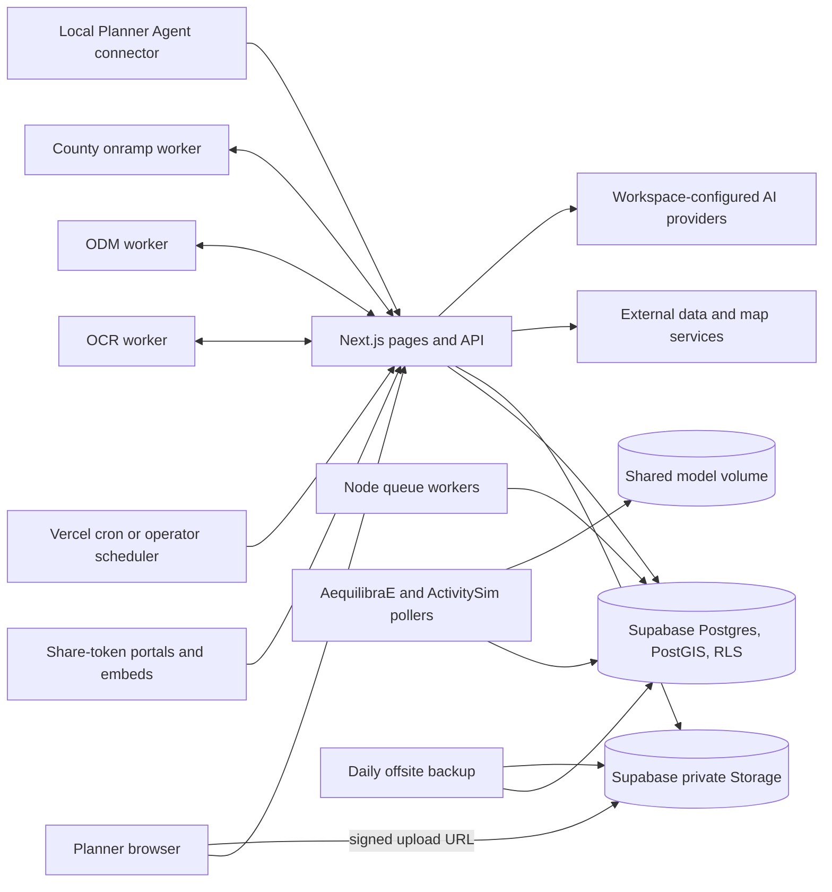

# OpenPlan architecture

Reconciled November 2, 2026 against `main` at `de7c950`. Each section was checked
against the code paths it cites. This document describes what is built. The
[V1 contract](product/V1_PRODUCT_CONTRACT.md) defines the destination, the
[roadmap](ROADMAP.md) holds the queue, and [known issues](ops/KNOWN_ISSUES.md)
holds open defects. The September 6 description, including its proposed
designs, remains in Git history (`git show de7c950:docs/ARCHITECTURE.md`); the
proposals now live in the milestone and review documents listed under
[Planned structure](#planned-structure).

Paths are under `openplan/` unless they start with `openplan/`, `workers/`,
`scripts/`, `docs/`, `data/` or `qa-harness/`.

## Repository map

| Location | Responsibility |
|---|---|
| `openplan/` | Next.js 16 web app (`package.json`), API routes, Node queue workers and Supabase migrations |
| `src/app/` | Planner pages `(app)`, sign-in `(auth)`, public share-token pages `(portal)`, `(published)` and `(embed)`, static pages `(public)`, and `api/` routes |
| `src/lib/`, `src/components/` | Domain logic, source adapters, permissions and UI, one folder per module |
| `supabase/migrations/` | Forward migrations (448 files at `de7c950`) |
| `openplan/scripts/workers/` | Node queue workers that claim work from Postgres |
| `workers/` | Python model, OCR, imagery and county services; hosted images; the local Planner Agent connector |
| `scripts/modeling/`, `scripts/research/`, `data/modeling/`, `schemas/` | Offline scientific preparation, published evidence and its contracts |
| `qa-harness/` | Browser journeys and regression scripts |
| `.github/workflows/` | CI, RLS isolation, worker, upgrade, restore, health and source-contract checks |

The diagram maps responsibilities. It is not a security certification.

## Module map

Each planner surface has a page folder under `src/app/(app)/`, API routes under
`src/app/api/` and logic under `src/lib/`.

| Surface | Pages | Main logic |
|---|---|---|
| Projects, portfolio import and GeoPackage export | `projects/` | `src/lib/projects/`, `src/lib/project-evidence-bundles/` |
| Plans, land-use plans, RTP cycles | `plans/`, `land-use-plans/`, `rtp/` | `src/lib/plans/`, `src/lib/land-use-plans/`, `src/lib/rtp/` |
| Programs, work programs (OWP/UPWP), grants, invoicing | `programs/`, `grants/`, `invoicing/` | `src/lib/programs/`, `src/lib/grants/`, `src/lib/invoicing/`, `src/lib/money/` |
| Data Hub, workspace GIS, transit feeds | `data-hub/` | `src/lib/workspace-gis/`, `src/lib/data-sources/`, `src/lib/gtfs/`, `src/lib/transit/` |
| Knowledge Base and document extraction | `knowledge-base/` | `src/lib/knowledge-base/`, `src/lib/document-library/` |
| Corridor analysis, models, county runs, scenarios | `explore/`, `models/`, `county-runs/`, `scenarios/` | `src/lib/analysis/`, `src/lib/models/`, `src/lib/scenarios/` |
| Safety and benefit-cost | `safety/`, `grants/bca/` | `src/lib/safety/`, `src/lib/bca/` |
| Engagement and public portals | `engagement/` | `src/lib/engagement/` |
| Reports | `reports/` | `src/lib/reports/` |
| Map packages | `maps/` | `src/lib/map-packages/` |
| Aerial missions and processing | `aerial/` | `src/lib/aerial/` |
| Dashboard, My Work, assistant activity | `dashboard/`, `my-work/`, `assistant-activity/` | `src/lib/dashboard/`, `src/lib/my-work/`, `src/lib/assistant/` |

`/billing` only redirects to `/invoicing` (`src/app/(app)/billing/page.tsx`);
there is no subscription or checkout. Product direction makes projects and
statutory plans the owners of shared context (AGENTS.md, "Product decisions");
the modules above do not yet form one connected record.

## Geography and authority

- Place search and boundaries go through `src/lib/geographies/place-resolver.ts`
  (Census TIGERweb, layers in `src/lib/geographies/tigerweb-services.ts`), the
  routes under `src/app/api/geographies/`, and the picker in
  `src/components/models/study-area-picker.tsx`.
- `src/lib/geographies/place-of-record.ts` keeps place identity apart from
  geometry. A drawn or uploaded area has no administrative reference.
- Place kinds are county, city or town (incorporated place), census-designated
  place, metropolitan and micropolitan area, tribal area (American Indian,
  Alaska Native and Native Hawaiian areas) and town or township (county
  subdivision), in `src/lib/api/place-geographies.ts`. There is no state, MPO
  or territory kind; territories appear only in `src/lib/geographies/state-fips.ts`.
- Land-use plan creation takes the descriptor and plan kind named in the
  command (`src/lib/land-use-plans/create-command.ts`) and checks them against
  the registry (`src/lib/land-use-plans/registry.ts`). Workspace home no longer
  constrains it; the only home-based function, the descriptor recommendation,
  has no production caller. The selectable descriptors are California and an
  unconfigured local plan.
- Remaining place and authority gaps are in [Known structural limits](#known-structural-limits).

## Trust boundaries

**Identity and roles.** Supabase Auth runs through `src/proxy.ts` and
`src/lib/supabase/middleware.ts`. `src/lib/workspaces/current.ts` selects the
workspace from the active-workspace cookie only while it names a real
membership. `src/lib/auth/role-matrix.ts` defines the owner, admin, member and
viewer roles and the matrix of 24 named workspace actions.

**Database.** RLS, grants and append-only triggers in the migrations enforce
record boundaries; new tables get no grants by default
(`supabase/migrations/20260804000001_default_deny_new_table_grants.sql`).
`src/test/migrations/inventory.test.ts` asserts that all 333 parsed tables
enable RLS, by count. The RLS Isolation workflow runs live policy tests in CI.

**Service role.** `createServiceRoleClient()` in `src/lib/supabase/server.ts`
bypasses RLS. 147 non-test files under `src/app` reference it at `de7c950`, and
no guard limits which files may. Each such route carries its own checks; see the
[service-role note](#known-structural-limits).

**Public surfaces.** Share-token pages live in `(portal)` (engagement),
`(published)` (plans, measures, land-use review) and `(embed)`. Token handling
is per module, for example `src/lib/engagement/public-portal.ts` and
`src/lib/land-use-plans/public.ts`. `next.config.ts` sends a framing-forbidding
security policy everywhere except `/embed`.

**Agent writes.** The action registry (`src/lib/runtime/action-registry.ts`,
`src/lib/runtime/action-metadata.ts`) lists 12 actions, all requiring approval.
`src/lib/assistant/action-approval-server.ts` hashes the canonical payload,
checks it against a single-use approval row for the same user, workspace and
action within five minutes, and consumes it. `src/lib/assistant/agent-principal.ts`
records agent authorship separately from the approving person. The execution
source header is in-app attribution, not a delegated credential. Agent stage
gate holds consume the approval, write the decision and write the audit
receipt in one database function
(`supabase/migrations/20261008000001_assistant_hold_receipts.sql`), with retry
recovery in `src/lib/assistant/stage-gate-hold-receipt.ts`. No MCP server is
built; [ADR-004](ADRs/ADR-004-mcp-server-surface.md) defers it.

**AI providers and keys.**

| Task | Providers | Path |
|---|---|---|
| Assistant chat | Anthropic | `src/app/api/assistant/chat/route.ts` |
| Saved-API chat | Workspace API connection (OpenAI-compatible) | `src/app/api/assistant/providers/chat/route.ts` |
| Project read and draft | API connection, Anthropic, or installed Codex, Claude Code or OpenCode | `src/app/api/assistant/providers/turns/route.ts`, `workers/planner_agent_connector/` |
| Map packages | Installed Claude Code with a Claude subscription | `src/lib/map-packages/contracts.ts` |
| Translation, grant, report and RTP drafting, extraction, moderation | Anthropic | `src/lib/integrations/anthropic-access.ts` |

Model choices come from `src/lib/ai/model-policy.ts`. Workspace keys are
encrypted with AES-256-GCM (`src/lib/integrations/key-crypto.ts`) under
`OPENPLAN_INTEGRATION_KEY_SECRET` and stored in service-role-only tables
(`src/lib/integrations/workspace-keys.ts`). In production a deployment
`ANTHROPIC_API_KEY` serves workspaces only when `OPENPLAN_SHARED_AI_KEY` is
`allow` (`src/lib/integrations/shared-ai-key.ts`); the hosted installation
must never set it (AGENTS.md). AI calls are rate limited per workspace
(`src/lib/runtime/ai-rate-limit.ts`). The code has no dollar cap; the hosted
demo's $5 cap is set at the provider.

## Workers and queues

Long work runs in workers, not in a web request. Node queue workers
(`openplan/scripts/workers/`) claim and lease rows through Postgres functions. The model
pollers claim `model_run_stages` rows. OCR, ODM and county services receive
HTTP requests and report back through callback routes.

| Worker | How it gets work | Hosted on Railway |
|---|---|---|
| Document exports, engagement email, provider API turns, translation, synthesis preparation, synthesis execution, contract calculations | Postgres claim functions | Yes, one service under `workers/hosted-node/supervise.mjs` |
| Managed GTFS ingestion (`openplan/scripts/workers/gtfs-ingestion.ts`) | `src/lib/gtfs/managed-worker-queue.ts`; off unless `OPENPLAN_GTFS_MANAGED_INGESTION` is `1` | No |
| Synthesis generation (`openplan/scripts/workers/synthesis-generation.ts`) | Operator command for one authorization | No |
| AequilibraE and ActivitySim | Poll queued stages; lease through 30-second heartbeats (`workers/aequilibrae_worker/model_stage_lease.py`) | Yes, one service on one shared volume (`workers/hosted-models/supervise.py`) |
| OCR (`workers/ocr_worker/main.py`) | App request or polling `src/app/api/knowledge-base/extraction-dispatch/route.ts`; results to `src/app/api/knowledge-base/ocr-callback/route.ts`; SQLite journal in `workers/ocr_worker/durable.py` | Yes |
| Offsite backup (`workers/hosted-backup/backup.py`) | Daily Railway cron (`workers/hosted-backup/railway.json`) | Yes |
| ODM imagery (`workers/odm_worker/main.py`) | App request; callbacks to `src/app/api/aerial/processing-callback/route.ts`; in-memory queue unless managed admission is enabled | No |
| County onramp (`workers/county_onramp_worker/main.py`) | App request (`src/lib/api/county-onramp-dispatch.ts`); callbacks to `src/app/api/county-runs/[countyRunId]/manifest/route.ts`; in-memory job table | No |
| Planner Agent connector (`workers/planner_agent_connector/connector.mjs`) | Runs on the planner's computer; claims turns from `src/app/api/assistant/providers/native/route.ts` and map packages from `src/app/api/map-packages/connector/route.ts` with a one-time connection token | No |

Railway service settings and secrets are listed in
[hosted operations](../openplan/docs/ops/HOSTED_OPERATIONS.md). Each worker's
DEPLOY document governs its own operation. `workers/aequilibrae_worker/railway.json`
and its Fly files are standalone self-hosting recipes, not the hosted layout.

Model pollers mark their own stages interrupted after a 15-minute heartbeat
lapse and leave them for the owner's recovery decision; nothing retries
automatically. The `reap-model-runs` cron (`src/lib/models/run-reaper.ts`) fails
only stale work that never started.

**Scheduled routes.** `vercel.json` schedules five routes under
`src/app/api/cron/`: model-run and GTFS reapers, the deadline sweep, and sweeps
of unattached engagement photos and abandoned staged uploads. Each requires
`Authorization: Bearer` with `CRON_SECRET`. A self-hosted operator supplies the
scheduler ([self-hosting](../openplan/docs/SELF_HOSTING.md)).

## External data and adapters

Self-hosting does not mean no outbound traffic. No outbound-service inventory
exists yet. `src/lib/http/outbound-url.ts` guards member-supplied URLs, and
`src/lib/integrations/providers.ts` lists the services a workspace can bring its
own key for.

| Source | Adapter |
|---|---|
| Census ACS, FCC block lookup | `src/lib/data-sources/census.ts` |
| Census TIGERweb places, boundaries and road context | `src/lib/geographies/tigerweb-services.ts`, `src/lib/safety/us-road-context-adapter.ts` |
| LODES employment | `src/lib/data-sources/lodes.ts` |
| OpenStreetMap through Overpass | `src/lib/data-sources/transit/osm-overpass.ts` |
| GTFS feeds and the Mobility Database catalog | `src/lib/gtfs/catalog.ts`, `src/lib/gtfs/fetch.ts` |
| Grants.gov | `src/lib/grants/grants-gov.ts` |
| CEJST, bundled with no network call | `src/lib/data-sources/equity-designation/cejst-national.ts` |
| Crash records | `src/lib/safety/sources/registry.ts` (below) |
| Mapbox geocoding, static images and tiles | `src/lib/engagement/place-search.ts`, `src/components/workspace-gis/layer-placement-preview.tsx` |
| Resend email | `src/lib/notifications/engagement.ts` and Supabase Auth SMTP |

**Crash sources.** The registry picks adapters by the study area's state FIPS
code, not its bounding box. It holds California CCRS, Oregon DOT, Iowa DOT,
Ohio DOT, DC DDOT and national NHTSA FARS (fatal only). Only CCRS and FARS
records can be stored (`OBSERVED_CRASH_SOURCE_IDS`); the four state adapters
answer live reads and corridor runs only.

**Maps.** All map components start through `src/lib/maps/map-engine.ts`. It uses
Mapbox when `NEXT_PUBLIC_MAPBOX_ACCESS_TOKEN` holds a public token, otherwise a
MapLibre style named by `NEXT_PUBLIC_OPENPLAN_MAP_STYLE_URL`
(`src/lib/cartographic/open-map-style.ts`), otherwise an unavailable notice.
`next.config.ts` adds that style's origin to the content security policy. Place
search and the background picker still need Mapbox.

## Uploads, imports and exports

- Large planner files go straight from the browser to private Storage through
  a signed URL, and the complete step re-reads and checks the stored object
  (`src/lib/files/staged-upload.ts`). Knowledge Base documents, aerial imagery
  and GTFS uploads use it. Map packages issue their own signed URLs
  (`src/lib/map-packages/server.ts`), outside the staged-upload sweep.
- Default GTFS imports still run inside the request; the managed worker path is
  opt-in ([managed ingestion](../openplan/docs/ops/GTFS_MANAGED_INGESTION.md)).
- Portfolio workbook import creates or skips rows; it does not reconcile edited
  records (`src/app/api/projects/import/route.ts`).
- One GeoPackage builder serves both exports
  (`src/lib/projects/project-geopackage.ts`). Direct export includes project,
  corridors and engagement geometry; governed export
  (`src/lib/project-evidence-bundles/generated-records.ts`) adds crashes. No
  production caller passes model layers or land-use designations.
- Report PDFs render with headless Chromium (`src/lib/reports/pdf.ts`) on Vercel
  and in the hosted queue image.

## Model science

AequilibraE and ActivitySim are separate demand methods; AGENTS.md forbids
averaging them and treats agreement as sensitivity evidence, not accuracy. Read
[ADR-002](ADRs/ADR-002-multi-engine-modeling-stack.md), the
[modeling status](modeling/STATUS_AND_VALIDATION.md) and the
[ActivitySim runtime gap](modeling/ACTIVITYSIM_RUNTIME_GAP.md) for what is
validated. The hosted model image pins Python 3.11, AequilibraE 1.6.2 and Pandas
2.3.3 and checks them at build (`workers/hosted-models/DEPLOY.md`). Hosted run
artifacts are mirrored to the private `run-artifacts` bucket when
`OPENPLAN_HOSTED_ARTIFACT_MIRROR` is `1`; the two pollers still exchange
`local://` files on the shared volume.

## Deployment and migrations

Hosted operation, merge holds and migration order are governed by AGENTS.md
("Live hosted installation") and the coordination file it names. Do not repeat
them here. The code-side facts are these:

- `vercel.json` deploys only `main`, runs `npm ci` and `npm run build`, gives
  three report and export routes 60 seconds and 1,024 MB, and schedules the
  cron routes.
- `npm run build` runs `next build --webpack` with a 6,144 MB heap. On Vercel,
  `next.config.ts` skips the type check and disables webpack's filesystem cache,
  because both pushed the 8 GB builder out of memory (October 23 and
  November 2, 2026); CI builds keep both.
- At build, `next.config.ts` records every migration version in the tree.
  `src/app/api/health/route.ts` reports version, commit and expected migrations;
  `src/app/api/health/deep/route.ts` (bearer `OPENPLAN_HEALTH_TOKEN`) also probes
  the database, model heartbeats and Node queue processes.
- Git deploys never apply migrations. The upgrade-path workflow upgrades a
  database in place from the previous release tag, and the restore drill runs
  quarterly. [Backup and restore](../openplan/docs/ops/BACKUP_AND_RESTORE.md)
  and [hosted recovery](../openplan/docs/ops/HOSTED_RECOVERY.md) hold the
  procedures and their limits.

## Known structural limits

| Limit | Row |
|---|---|
| A model stage has no durable lease or resume point in its own columns | KI-2026-10-12-018 |
| County run routes read worker files from the app's own disk | KL-2026-09-04-041 |
| ODM queue is in memory by default; mesh is not delivered; DNG is accepted by the UI but not by intake | KL-2026-09-04-051, KL-2026-09-04-052 |
| No outbound-service inventory or tested no-egress operation | KL-2026-09-04-012 |
| Place search needs Mapbox; several maps lack browser checks | KI-2026-10-12-026 |
| Land-use plan geography can change after context is saved; creation assumes TIGERweb | KI-2026-10-12-025 |
| Injury crash records outside California cannot be stored | KI-2026-11-02-001 |
| No error tracking or cron failure alerts on the hosted site | KI-2026-10-12-033 |
| Per-account workspace, storage and AI cost limits are partial | KI-2026-10-12-014 |
| Local model artifact downloads refuse on non-Linux hosts | KI-2026-10-12-031 |
| No guard limits which routes use the service-role client | No row yet |

Rows are in [known issues](ops/KNOWN_ISSUES.md).

## Planned structure

These designs are not built. Their requirements live in the milestone
definitions and the dated research behind them.

| Area | Milestones | Design source |
|---|---|---|
| Plan-owned authority and legal applicability | M1, G1, G1a | [MILESTONES](product/MILESTONES.md); [national comparison](reviews/2026-09-04-pre-handoff/NATIONAL_LOCAL_ASSISTANCE_COMPARISON.md) |
| Contract budgets and RTP updates | M11, M12 | [contract budget review](reviews/2026-09-04-pre-handoff/CONTRACT_BUDGET_CORE_REQUIREMENTS_REVIEW.md); [RTP review](reviews/2026-09-04-pre-handoff/RTP_UPDATE_CORE_REQUIREMENTS_REVIEW.md) |
| Administered programs and recipient reporting | M13 | [local tax research](reviews/2026-09-04-pre-handoff/LOCAL_TAX_PROGRAM_ADMINISTRATION_RESEARCH.md) |
| Procurement and contract handoff | M14 | [agency procurement research](reviews/2026-09-04-pre-handoff/PROCUREMENT_AGENCY_REQUIREMENTS_RESEARCH.md) |
| Capital delivery and local assistance | M10 | [LAPM gap analysis](reviews/2026-09-04-pre-handoff/LAPM_FEATURE_GAP_ANALYSIS.md) |
| OWP/UPWP administration | M2d | [OWP research](reviews/2026-09-04-pre-handoff/OWP_ADMINISTRATION_REQUIREMENTS_RESEARCH.md) |
| Aerial processing and delivery | M5b.1–6 | [aerial decision](reviews/2026-09-04-pre-handoff/AERIAL_REUSE_AND_IMPLEMENTATION_DECISION.md) |
| Agent assignments, MCP and outside clients | A0, A1a–d | [agentic control decision](reviews/2026-09-04-pre-handoff/AGENTIC_CONTROL_DECISION.md); [ADR-004](ADRs/ADR-004-mcp-server-surface.md) |
| Hosted trials and customer-owned installation | M15a–c | [cutover record](ops/HOSTED_LIVE_2026-10-11.md) |

[ADR-003](ADRs/ADR-003-crash-data-acquisition.md) records the July crash source
decision; the state adapter registry above is what runs now. ADRs preserve
dated reasoning; verify current third-party APIs and licenses before building
from them.
