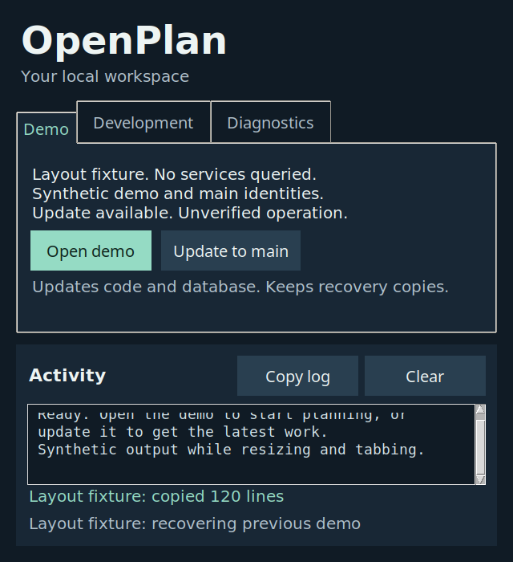

# Combined worker recovery and private aerial custody candidate

Current continuation: [October13 corrected join](../2026-10-13-m3-corrected-stack/STATUS.md). The checkpoints below retain their original state; hosted03 has since been applied, and264/266 now join the candidate.

The isolated candidate joins all [26 owned open PR heads](evidence/owned-pr-ancestry.json)
without rewriting their history. It includes the exact PR262 authority parent,
the separate PR205 worker-root parent and fetched main `473785491`. This is local
ancestry evidence. The individual PRs remain open at this checkpoint, and no
main merge, hosted migration apply, default activation or release is claimed.

The existing M3 and M5b.2 boundaries remain. The retained installation inventory,
root set, recovery packet, OCR proof and aerial custody layers deepen existing
capabilities. They do not establish complete independent installation or every
worker's recovery. The roadmap remains the sole queue.

## Combined checks

All 29 aerial YAML run blocks pass using the workflow's bash fail-fast options.
The [replay](evidence/workflow-results.json) runs 20 unittest suites with 529
cases, plus seven scenario programs. All 20 release/documentation tests pass.
The final missing-deadline refusal is included in this replay. Product direction
passes with its existing review reminders. Worker source hashes match after the
controllers restore their variants.

The replay takes 321.47 seconds and peaks at 917,499,904 bytes under a one-GiB
limit. Memory events report zero max, OOM or OOM-kill events. This is one serial
verification workload, not production concurrency or spare-capacity acceptance.

The [follow-up](evidence/followup-results.json) runs all 20 operations suite
programs independently, matching their CI execution form. They contain 295
unittest cases and two additional scripted suites. Existing layout, panel,
safe-refresh and demo-database mutation steps pass. All 59 aerial application
tests, scoped TypeScript and changed-file lint pass. Its
[peak](evidence/followup-resources.json) is 375,382,016 bytes under one GiB, with
zero max or OOM events. Both owned units stop.

The installed synthetic RPC fixture passes [14 cases](evidence/native-rpc-controls.json)
and [eight classifiers](evidence/native-rpc-oracles.json). Current revocation
refuses before the next intent; a stalled current-access read uses the actual
shared deadline. Changed-original and promoted-revocation faults fail their
selected assertions. The [bindings](evidence/native-rpc-source-bindings.json)
match this checkout and both [fixture services stop](evidence/native-rpc-stopped.json).
This retained fixture uses the older 405-migration schema with synthetic rows.
It is not a current hosted-data restore or a native engine-attestation proof.

## Control-panel layout correction

The first aggregate operations run reports one failure among 298 unittest cases.
At 640 by 700 pixels and double Tk scale, the update/recovery label receives 26
pixels while needing 28. A direct run of the existing layout program reproduces
the same failure. Main has identical panel and test files, so this defect is
inherited rather than introduced by the joined custody layers.

The correction reduces the gap below the demo summary from 12 to eight pixels.
The existing geometry, output-height, label and keyboard checks pass at both
declared scales and window sizes. The test and all application commands remain
unchanged. Removing the notebook's fixed height or increasing the tab minimum
instead collapses output; those [failed variants](evidence/preceding-failures.json)
remain visible.

The [detached controller](verify_layout_controls.py) passes four controls:
baseline, harmless comment and restored source survive; restoring the preceding
gap fails the intended clipped-label assertion. Ten classifier inputs pass.
An [accept-all classifier](evidence/layout-classifier-fault.json) fails its
own intended assertion. Production source is never edited by these controls.

Six [rendered fixture views](evidence/provenance.json) cover all three tabs at
820 by 760 and 640 by 700, with their respective scales. All six are inspected.
The final captures allow X11 redraw to settle; the preceding immediate captures
can overtake paint and remain private as superseded evidence. Status queries and
application commands are forbidden throughout. These are owned synthetic Xvfb
views, not T3 navigation, web desktop/390px evidence or live operational acceptance.

## Hosted and release boundary

Read-only hosted preflight on October 12 confirms transit migrations 28 through
31, survey-count02 and money-integrity05 are recorded. Aerial03, its private
schema and both public service-only RPCs are absent. UTF-8 and the required
digest overload are present. No real-user fixtures are written.

The recorded rollout covers only
`20261017000003_aerial_private_dispatch_custody.sql`, SHA-256
`4b0814b6f4e426261c8e3651b89812b50cc1c8226fd7ed2ec493c3b7f23d73f9`.
After current-head acceptance, take a fresh verified database and complete Storage
capture, apply the additive migration and its history row transactionally, verify
SQL/grants/RLS/private-schema non-exposure, then coordinate the dependent code
merge. Preserve the disabled flags and verify the resulting production commit
before another merge. No capture or apply has occurred at this checkpoint.

Exact-head GitHub checks, the schema-first hosted rollout and production health
remain separate. Native engine identity/attestation, uncertain effect
reconciliation, processing commit, result/artifact/callback custody, clean agency
installation, cross-host recovery and useful long computation remain open.
This work establishes no practitioner or scientific acceptance and does not
declare full M3 or v1 complete. GPT-6.1 Sol at high reasoning performs this joined
implementation and verification; no fresh independent review is claimed.
